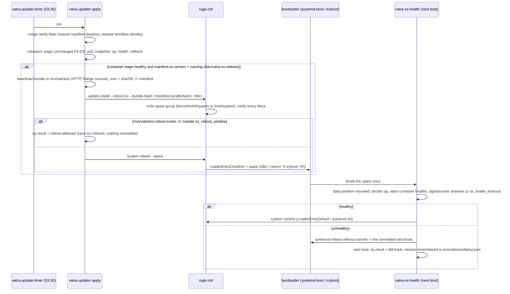

# A/B OS updates (P5-04)

Decision (PLAN.md, "Decisions for P10 / P11 / P5-04"): **Rugix Ctrl** drives the bootloader
(`rpi-tryboot` on Pi 4 / Pi 5, `systemd-boot` one-shot on x86), the system slots are **EROFS**
and read-only, state lives on an **ext4 data partition**, and **vatra-updater keeps the policy**:
the signed channel manifest carries an `os` block, the bundle is hash-pinned by it, a health unit
commits or falls back.

## Pinned versions

| Component    | Version                     | Source                                                     | sha256 (release asset)                                                                      |
| ------------ | --------------------------- | ---------------------------------------------------------- | ------------------------------------------------------------------------------------------- |
| Rugix Ctrl   | v1.4.0 (MIT OR Apache-2.0)  | `binaries-x86_64-unknown-linux-musl.tar`                   | `4f90e9d09f1b04374911581131baf9a1c5105300e04e1b4bd18c4a4c65ef01be`                          |
|              |                             | `binaries-aarch64-unknown-linux-musl.tar`                  | `db5e53d4726ba99f05b9fa990e7067cd80d60ec9a7b3b92b2999c88c8fe3f6b4`                          |
| Rugix Bundler| v1.4.0 (same tarballs)      | `rugix-bundler` in the tarball above                       | (covered by the tarball hash)                                                               |
| systemd-boot | Debian 13 `systemd-boot-efi`| copied from the image rootfs into the ESP                  | follows the Debian security archive                                                        |

The pin lives in [deploy/vatra/os/rugix-pin.sh](../../deploy/vatra/os/rugix-pin.sh); every script
that downloads Rugix verifies the tarball against it. `rugix-ctrl v1.4.0` was confirmed by running
the binary (cloud run `2611071938-m25f`).

## Layout

### x86 (GPT, `deploy/vatra/x86/ab-image.sh`)

| # | Label            | Size    | FS     | Content                                                                                  |
| - | ---------------- | ------- | ------ | ---------------------------------------------------------------------------------------- |
| 1 | `vatra-esp`      | 512 MiB | vfat   | `EFI/BOOT/BOOTX64.EFI` (systemd-boot), `loader/entries/vatra-{a,b}.conf`, `vatra/{a,b}/{vmlinuz,initrd.img}`. Rugix's config partition (read-only at `/run/rugix/mounts/config`, bound to `/efi` for `bootctl`) |
| 2 | `vatra-system-a` | 4 GiB   | EROFS  | rootfs, lz4hc                                                                            |
| 3 | `vatra-system-b` | 4 GiB   | EROFS  | empty until the first OS update                                                          |
| 4 | `vatra-data`     | rest    | ext4   | state (below); grown to the disk by `vatra-firstboot`                                    |

Loader entries: `root=PARTUUID=<slot> rootfstype=erofs ro init=/usr/bin/rugix-ctrl`. The kernel
and initrd of a slot are Rugix **custom slots** (`vatra-esp-slot`: remount the ESP rw, write
`.new`, fsync, rename, remount ro), so a power cut never leaves a half-written kernel behind the
entry that is booted.

### Raspberry Pi 4 / Pi 5 (MBR, `deploy/vatra/pi-image/ab.sh`)

| # | Name     | Size    | FS    | Content                                                                         |
| - | -------- | ------- | ----- | ------------------------------------------------------------------------------- |
| 1 | config   | 64 MiB  | FAT32 | `autoboot.txt` (`tryboot_a_b=1`, `boot_partition=2`, `[tryboot] boot_partition=3`), `vatra-setup.txt`, `vatra-wifi.txt` |
| 2 | boot-a   | 256 MiB | FAT32 | firmware, kernel, DTBs, `config.txt` (+`auto_initramfs=1`), `cmdline.txt`        |
| 3 | boot-b   | 256 MiB | FAT32 | empty until the first update                                                     |
| 4 | extended |         |       |                                                                                 |
| 5 | system-a | 4 GiB   | EROFS | rootfs                                                                          |
| 6 | system-b | 4 GiB   | EROFS | empty                                                                           |
| 7 | data     | 512 MiB | ext4  | grown to the card by `vatra-firstboot`                                          |

Rugix's `rpi-tryboot` flow patches the incoming boot partition's `cmdline.txt` with
`root=PARTUUID=<system slot>` and `init=/usr/bin/rugix-ctrl`; `ab.sh` does the same for slot A at
build time. `vatra-boot-firmware.service` makes partition 1 writable and binds it to
`/boot/firmware`, so the setup note and the wifi file stay where users look for them.

### What persists (`deploy/vatra/os/state/vatra.toml`)

`/srv/vatra` (compose, `.env` pins, vmui.db, HA / ESPHome / Mosquitto, updater config + OS
bundles), `/var/lib/docker`, `/var/lib/containerd`, `/var/lib/vatra` (firstboot stamp, setup code,
SSH host keys via `sshd_config.d/50-vatra-hostkeys.conf`), `/var/lib/systemd/timers`,
`/var/log/journal`, `/etc/NetworkManager/system-connections`, `/etc/hostname`, `/etc/hosts`.
Rugix keeps `/etc/machine-id` itself. Everything else is an overlay on the data partition that
is **discarded at every boot** (`overlay = "discard"`), so an undeclared write never survives and
never breaks the next slot.

## Update flow



Order: the **OS stage runs after the container stage** and only when it ended healthy (exit 0).
A hub that just rolled back its containers is not rebooted on top of that, and a new OS is never
judged against half-updated containers. `vatra-updater os-apply` runs the OS stage alone.

### Trust chain

The manifest is the only signed object (`cosign sign-blob` in `release-image.yml`, verified
against the workflow identity). For each platform it carries `url`, `sha256` and `size` of the
`.rugixb` file and its Rugix `bundleHash` (`rugix-bundler hash` = hash of the bundle header, a
Merkle root over every payload block). The updater checks size + sha256 before anything runs, then
hands `--bundle-hash` to Rugix, which verifies every block as it writes it. A tampered URL, mirror
or download therefore fails twice; the manifest's signature covers both hashes.

`scripts/channel-manifest.mjs --os-index <os-index.json> --os-base-url <release download url>`
computes `sha256` + `size` from the bundle files itself (it does not trust the index for them).

### Manifest `os` block

```json
"os": {
  "version": "1.2.0",
  "platforms": {
    "x86": { "url": "https://github.com/…/download/v0.6.0/vatra-os-x86-1.2.0.rugixb",
             "sha256": "<64 hex>", "size": 412345678, "bundleHash": "sha512-256:<64 hex>" },
    "pi5": { … }, "pi4": { … }
  }
}
```

### Status (`/srv/vatra/data/update-status.json`, `os` sub-object)

| `os.result`        | Meaning                                                                 | Updater exit |
| ------------------ | ----------------------------------------------------------------------- | ------------ |
| `up-to-date`       | running = manifest version                                              | 0            |
| `not-ab` / `no-bundle` | classic image, or no bundle for this platform                       | 0            |
| `refused`          | downgrade, sha256 / size mismatch, bad `os` block                       | 1            |
| `installed` → `rebooting` | spare written, one-shot set                                      | 0            |
| `reboot-deferred`  | `/run/vatra/no-reboot` present or outside `os_reboot_window`            | 0            |
| `install-failed` / `reboot-failed` / `commit-failed` | Rugix error (text in `reason`)         | 3            |
| `committed`        | health passed on the new slot (`previous` = old version)                | 0            |
| `health-failed`    | health failed, rebooting uncommitted                                    | 2            |
| `fell-back`        | back on the committed slot; this version is not retried                 | 2            |
| `skipped-failed`   | manifest still names a version that fell back here                      | 0            |

Config (`/srv/vatra/updater.json`): `os_reboot_window` (`"02:00-06:00"` local, may wrap midnight,
or `"always"`), `os_health_timeout` (600 s), `os_release`, `no_reboot_flag`, `rugix`.

Anything that must not be interrupted (an intercom call, a firmware flash, a restore) creates
`/run/vatra/no-reboot` and removes it when done; `/run` is tmpfs, so a crash never leaves it
stuck.

## Build

```powershell
# x86 A/B disk + bundle + QEMU/OVMF smoke (nested-virt spot VM)
node scripts/e2e-cloud/run.mjs --nested --machine n2-standard-8 --max-run 3h --fetch test-results --cmd "VATRA_AB=1 bash deploy/vatra/x86/build.sh"
```

`ab-image.sh` converts the Packer qcow2 (built with `-var ab=1`, which runs `os/rootfs-ab.sh`
inside the build VM) into the A/B disk; `os/bundle.sh` makes `system.erofs` + kernel/initrd (x86)
or `boot.vfat` + `system.erofs` (Pi), the `.rugixb` and `os-index.json`. A Pi card is made from
the classic rpi-image-gen output by `pi-image/ab.sh  pi4|pi5 <version> <out>` on the arm64
build host (chroot, then the same `bundle.sh`).

Unit tests: `python -m unittest discover -s deploy/vatra/updater` (fake `rugix-ctrl` + bootloader
state in `test_os_stage.py`), `pnpm exec vitest run src/lib/api/channel-manifest.test.ts`.

## Cloud smoke (x86): `deploy/vatra/os/ab-smoke-x86.sh`

QEMU q35 + OVMF with a writable `OVMF_VARS` (real systemd-boot, real EFI variables), the bundle
server and a throwaway cosign key on the host:

1. boot slot A: Rugix as init, `rugix-ctrl system info` = `systemd-boot`, active `a`, state
   `Active`; system slot EROFS, data ext4; `/api/discover` answers.
2. manifest with `os` = version + 1 → `vatra-updater os-apply` → bundle into B, `system reboot
   --spare` → boots B → `vatra-os-health` commits (active = default = `b`), `/srv/vatra/data`
   survived the switch.
3. manifest with version + 2 whose system image masks docker → into A, boots A once → health fails
   → reboot uncommitted → systemd-boot boots B again → `os.result = fell-back`, hub serving.

Results: see "Smoke runs" below.

## Real-hardware QA (Pi tryboot cannot run in QEMU)

Run on one Pi 4 (4 GB, SD card) and one Pi 5 (SD and NVMe if available), with a serial console
(GPIO 14/15, 115200) or HDMI, on the bench network. Record board, bootloader EEPROM version
(`rpi-eeprom-update`), card, timings and the `update-status.json` after each step.

1. **EEPROM**: Pi 4 needs a bootloader from 2021-05 or newer for `tryboot_a_b` (`rpi-eeprom-update`;
   update with `rpi-eeprom-update -a` on a stock Raspberry Pi OS card first). Pi 5 ships with it.
2. **Flash** `vatra-hub-piN-ab-<v>.img(.xz)` with Raspberry Pi Imager (custom image, no
   customisation). Check on a PC: the first FAT partition shows `autoboot.txt`.
3. **First boot**: console shows the Rugix banner, then systemd. Within 3 min: `vatra-setup.txt`
   appears on the config partition, `/api/discover` answers, `ssh` with a key added via the app
   works. On the hub: `rugix-ctrl system info` → `boot_flow` `rpi-tryboot`, `active_group` `a`,
   `default_group` `a`, `state.status` `Active`; `findmnt /run/rugix/mounts/system` = erofs,
   `/run/rugix/mounts/data` = ext4 and grown to the card (`lsblk`).
4. **Persistence**: claim the hub in the app, add a device, reboot twice: still claimed, same
   hostname, same SSH host key fingerprint.
5. **Good update**: publish a test manifest (or point `manifest_url` at a LAN copy signed with a
   test key, `verify: key`) with `os.version` +1 and the bundle from the same build;
   `vatra-updater os-apply`. Expect `os.result` `rebooting`, one reboot, the console shows
   `boot_partition=3` read by the firmware, then `vatra-os-health` → `committed`;
   `rugix-ctrl system info` active = default = `b`; `cat /boot/firmware/autoboot.txt` shows
   `boot_partition=3`. Time from `os-apply` to `committed`.
6. **Power cut during install**: start `os-apply`, pull power while `rugix-ctrl update install`
   writes (watch `journalctl -f`). Hub must come back on the committed slot; the next run
   re-downloads (`.part` resume) and installs.
7. **Power cut on the tried slot**: after the `rebooting` status, pull power while the new slot
   boots (before `committed`). Expect the committed slot on the next boot and `os.result`
   `fell-back`.
8. **Broken update**: bundle whose system image masks `docker.service` (as the smoke does): one
   boot of the new slot, `health-failed`, reboot, back on the committed slot, `fell-back`,
   version listed in `/srv/vatra/os/failed.json`, the next nightly run reports `skipped-failed`.
9. **no-reboot hook**: `touch /run/vatra/no-reboot`, run `os-apply`: `reboot-deferred`, no
   reboot; remove the file, `vatra-updater os-reboot`: reboots.
10. **Wifi + setup note**: put `vatra-wifi.txt` on the config partition from a PC, boot: joined,
    `vatra-wifi-result.txt` written (proves the rw bind of partition 1).
11. **Pi 5 + NVMe**: repeat 3 and 5 booting from NVMe (`BOOT_ORDER=0xf416`).

Known limits to check on hardware: the FAT `autoboot.txt` rewrite on commit is atomic only as far
as FAT rename is (Rugix docs, "On Atomicity of Commits"); the Pi 5 kernel uses 16K pages, so the
EROFS image is built with 4K blocks (`mkfs.erofs` default), which both kernels mount.

## Smoke runs

| Date | Run id | Result | Notes |
| ---- | ------ | ------ | ----- |
| 2026-11-07 | `2611071938-m25f` | probe | Rugix 1.4.0 tarball layout, CLI flags (`--reboot no`, `--bundle-hash`, `system reboot --spare`), bundle hash format `sha512-256:<hex>` |
| 2026-11-07 | `2611071948-l4ur` | fail | Packer `environment_vars` were not passed to the provision script (needs `{{ .Vars }}` in `execute_command`): image not A/B; fixed |
| 2026-11-07 | `2611071958-zjzp` | **pass** | n2-standard-8 nested KVM, 1191 s total (~0.03 USD): Packer 182 s, ab-image 86 s, smoke 631 s. `system.erofs` 751 MiB, bundle 799 MiB (837 010 819 B), A/B qcow2 708 MiB. Slot A up in 36 s, `/api/discover` in 62 s; `system info` flow `systemd-boot`, slots kernel/initrd/system a+b, state `Active` (`/dev/vda4`). Good update 0.4.0 → 0.4.1: rebooted into B 60 s after `os-apply`, committed at 64 s, data kept. Broken 0.4.2 (docker masked): booted A once at 78 s, health failed (`docker is not running`), back on committed B at 399 s, `os.result` `fell-back`, hub serving 0.4.1 |

`rugix-ctrl system info` (v1.4.0) prints camelCase (`bootFlow`, `activeGroup`, `defaultGroup`,
`dataPartition`) even though the sidex schema names them in snake_case; the updater normalises both.
